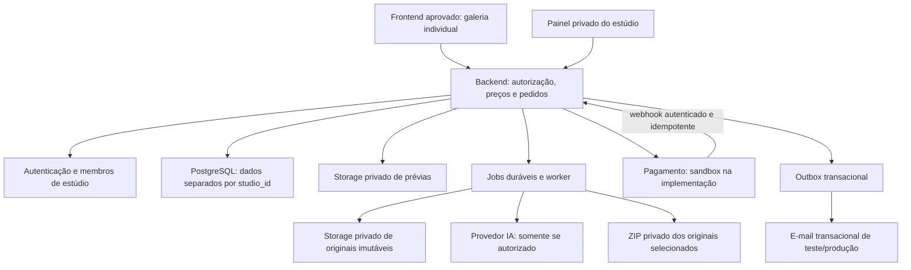

# 2. Arquitetura proposta — ainda não implementada

## Escolha recomendada

Manter o frontend HTML/CSS/JavaScript aprovado e adicionar um adaptador de API, sem reescrever sua apresentação visual. Criar painel em Next.js/TypeScript, backend HTTP no mesmo projeto e um worker separado para tarefas longas. PostgreSQL, autenticação e storage privado via Supabase são a recomendação inicial, condicionada à aprovação e à conferência de recursos existentes. Não foi criado projeto externo nem instalado framework nesta etapa.

Em produção futura, preferir uma origem HTTPS para `/g/...`, `/admin` e `/api/v1`, reduzindo problemas de cookies/CORS. O host deve servir a experiência atual da galeria preservando seu layout. O GitHub Pages atual continua como está até aprovação explícita de migração/publicação; ele não executa backend privado. Se forem usados domínios separados, serão necessários CORS restrito, sessão segura e testes próprios. Não há decisão de domínio/hosting contratado nesta proposta.



Este diagrama é uma proposta. Não indica serviços provisionados ou integrações funcionando.

## Estrutura futura do código

```text
index.html e MP3 existentes       frontend aprovado; preservados nesta fase
apps/studio/                     painel, endpoints e integração de autenticação
services/worker/                 processamento, IA, ZIP e notificações
packages/contracts/              contratos e validação compartilhada
packages/domain/                 dinheiro, estados e regras sem dependência de UI
supabase/migrations/             esquema e políticas revisados
supabase/tests/                  isolamento e acesso ao storage
tests/galeria/                  E2E, integração, fixtures e matriz de aceitação
```

A árvore acima é PLANEJADA, não scaffolding executável. Nesta entrega só são criados documentos e fixtures artificiais em `docs/galeria-belem`, `development` e `tests/galeria`. Nenhum frontend foi movido, nenhum package.json/lockfile foi criado e nenhuma dependência foi instalada.

O workflow atual publica a raiz inteira. Antes de qualquer futura implantação, separar o artefato público dos diretórios de backend, testes e documentação. Não alterar esse workflow nem dispará-lo nesta etapa.

## Modelo de dados, responsabilidades e isolamento

Entidades propostas; adaptar detalhes após aprovação, sem executar SQL agora:

| Entidade | Responsabilidade e invariantes |
|---|---|
| studios | Tenant, nome/marca, fuso, moeda e políticas. R$ 39,90 é preço-alvo do plano, não autorização de cobrança. |
| studio_memberships | Usuário autenticado, estúdio e função. Proprietária/admin; equipe futura com permissões menores. |
| clients | Dados mínimos necessários, sempre associados ao estúdio. |
| photo_sessions | Sessão inicialmente em rascunho, sem exigir cadastro de cliente antes da curadoria. Depois vinculada à cliente. |
| photos / photo_assets | ID estável; sessão; nome original; MIME/tamanho/hash; caminho/versionamento do original; prévia; revisão humana. |
| curation_runs / curation_suggestions | Execução, modelo/versão, score/motivo e custo estimado/real. Sugestão nunca publica sozinha. |
| galleries / gallery_photos | Publicação versionada; somente fotos aprovadas da sessão e mesmo tenant. |
| gallery_access_grants | Segredo individual de acesso, hash, validade, revogação, limite/escopo; não expor dados de outra família. |
| session_packages | Quantidade contratada e preço de adicional em centavos; fotografias extras precisam ter regra aprovada. |
| products / variants | Catálogo administrável: preços, imagens, descrição, variações, ativo/inativo. |
| selections / selection_items | IDs de fotos, revisão otimista e estado rascunho/finalizado. Fonte definitiva no servidor. |
| orders / order_items | Snapshot imutável de preços e itens aceitos; total calculado pelo servidor. |
| payments / payment_events | Tentativas, IDs externos, estado e eventos únicos do webhook. Não armazenar cartão. |
| jobs / exports | Jobs duráveis com tenant, permissões, lease, tentativas, erros e resultado expirável. |
| outbox / audit_events | Notificações transacionais com deduplicação; trilha de ações com minimização de dados. |
| entitlements / usage | Recursos liberados e consumo de storage/IA. Sem assinatura recorrente nem cobrança implementada. |

Todas as entidades de negócio têm `studio_id NOT NULL`. Chaves estrangeiras compostas e unicidade incluem o tenant para impedir vínculos cruzados, não apenas filtros na interface. IDs opacos/UUID não substituem autorização.

Políticas PostgreSQL RLS em todas as tabelas de negócio, default deny. Usuário do painel só acessa estúdios de que é membro e funções autorizadas. Cliente da galeria nunca ganha permissão ampla de banco: troca o link por sessão restrita e acessa endpoints limitados à galeria. Tokens/chaves privilegiados ficam só no servidor.

Workers ou SDKs com chave de serviço podem contornar RLS: por isso precisam de autorização explícita, `studio_id` validado no job e consultas sempre delimitadas, com testes de tentativa de cruzar estúdios. O isolamento precisa existir também nas filas, cache, logs, downloads, eventos de pagamento e notificações.

Prefixos de objeto como `<studio_id>/<session_id>/<photo_id>/<asset_version>` auxiliam organização, mas não são controle de acesso. Políticas do storage e autorização ao emitir URL assinada devem validar o objeto e o tenant. Bucket de originais e de ZIP sempre privado, sem URLs permanentes no navegador da família.

## Fluxo obrigatório e estados

1. Proprietária autenticada cria lote/sessão em rascunho e solicita upload direto privado autorizado. Backend valida tipo/tamanho, integridade e pertencimento, então confirma `uploaded`.
2. Worker gera prévia orientada corretamente e sem metadados privados de GPS. Original fica imutável; conversão RAW/HEIC exige compatibilidade definida. IA analisa prévias, registra sugestões e não altera originais.
3. Proprietária revisa/aprova/rejeita. Estado humano separado do score da IA; repetição de IA não apaga a decisão humana.
4. Cliente é cadastrada, vinculada à sessão e recebe quantidade contratada/preço adicional. Dados mínimos; não exigir CPF como identificador por conveniência.
5. Publicação cria versão consistente com SOMENTE fotos aprovadas, pacote e catálogo válido. Gera link individual; copiar é permitido no painel, envio externo automático não entra no escopo sem autorização.
6. Cliente abre link, assiste à abertura em vídeo aprovada e apresentação; autoplay bloqueado deve oferecer início por toque, legenda/alternativa quando aplicável e preferência de som preservada.
7. Seleciona, filtra e revisa fotos; backend confirma cada revisão e detecta conflitos. localStorage é cache/rascunho auxiliar; falha de salvamento aparece claramente.
8. Loja carrega catálogo do estúdio: caneca, álbum, quadro, camiseta, ímã e todos os arquivos digitais; não pressupor preço/variação/estoque.
9. Backend calcula quote e cria pedido idempotente com snapshot de itens. Pagamento em checkout hospedado pelo provedor, sem capturar cartão no sistema.
10. Webhook validado confirma pagamento; transação atualiza pedido e insere outbox. Notificação por e-mail só depois da confirmação. Quando total for zero, liberação sem pagamento segue regra expressamente aprovada.
11. Proprietária solicita ZIP; backend verifica novamente liberação e seleção final. Worker lê originais exatos e entrega link privado temporário.

Estados de pedido propostos: `draft → awaiting_payment → paid → released`, com exceções `payment_failed`, `cancelled`, `refunded` e disputas a definir. Retorno do navegador do checkout não confirma pagamento. Para total zero, transição específica para `released` sem inventar evento de pagamento. Seleção final/compra deve ser versionada e congelada ou revista por processo explícito; edição posterior não altera um pedido pago silenciosamente.

## Contratos de API propostos

- `/api/v1/admin/sessions`, `/uploads`, `/curation-runs`, `/clients`, `/galleries`, `/products`, `/orders`, `/exports`: autenticados, autorizados por tenant e função; nomes ilustrativos, não rotas existentes.
- `/api/v1/gallery/access`: troca de token por cookie HttpOnly/Secure de escopo restrito, expiração e revogação. Tokens com alta entropia e hash persistido; não registrar tokens completos em logs.
- `/api/v1/gallery/context`, `/selection`, `/quote`, `/orders`: sessão limitada à galeria; não aceitar `studio_id` ou preço fornecido pelo navegador como autoridade.
- `/api/v1/webhooks/payments`: assinatura e proteção contra replay; evento/idempotency key único por integração/conta do estúdio.
- Sessões via cookie exigem mitigação CSRF, validação de origem e configuração SameSite apropriada; CORS não substitui autenticação.
- Respostas privadas sem cache público compartilhado; links não devem vazar por referer/analytics. URLs de prévias expiram e precisam ser renovadas sem perder seleção.

## ZIP e originais: critério essencial

ZIP só para proprietária autorizada e pedido liberado. Cada item final aponta por ID e versão ao original de sua própria sessão e tenant. Não inferir original pela URL da prévia nem baixar imagem otimizada como substituta.

Preservar bytes, qualidade e nome de arquivo. Verificar hashes no upload e nos testes de extração. Nomes de diretório/caminhos não podem permitir ZIP Slip. Em colisões, preservar o nome original dentro de subpastas estáveis por foto, em vez de sobrescrever/renomear o arquivo; confirmar formato na aprovação. Job com objeto ausente deve falhar com diagnóstico, não entregar ZIP parcial como sucesso.

Tarefas grandes rodam fora dos limites de uma requisição HTTP curta, por streaming ou jobs retomáveis conforme o storage escolhido. ZIP tem expiração e limpeza; nunca endereço público permanente. Cancelamento/estorno antes de iniciar/entregar exige revalidar autorização/liberação. As regras para revogar acesso depois de download já realizado precisam ser comunicadas: não é possível recolher bytes já baixados.

## Segurança operacional e multiestúdio comercial

- MFA recomendada para proprietárias; sessões separadas de administradora e família; segredos por ambiente e rotação.
- Uploads com limites, allowlist de formatos e inspeção segura; imagens enormes/arquivos inválidos devem ser rejeitados sem executar conteúdo.
- Ações privilegiadas auditadas sem registrar segredos, originais ou dados pessoais desnecessários. Retenção e exclusão conforme política a aprovar, incluindo IA, cópias e backups.
- Backups do banco NÃO são por si só backup dos objetos de storage. Definir restauração de ambos e executar teste com dados artificiais antes de produção.
- Premium IA opt-in, execução limitada por quota/orçamento e autorização; indisponibilidade não publica fotos automaticamente.
- Plano básico-alvo R$ 39,90/mês com entitlements modelados. Nenhum checkout de assinatura, débito recorrente, criação de assinatura ou cobrança de excedente nesta fase.
- Recomendação: cadastro de novos estúdios controlado/manual no início. Futuro autoatendimento e cobrança só em etapa separada.
- Pagamentos das CLIENTES por pedidos são diferentes da assinatura dos ESTÚDIOS. Para outros fotógrafos, preferir recebimento em conta própria por estúdio ou solução de contas conectadas aprovada; não concentrar valores de terceiros na conta do Estúdio Lilian por padrão.
